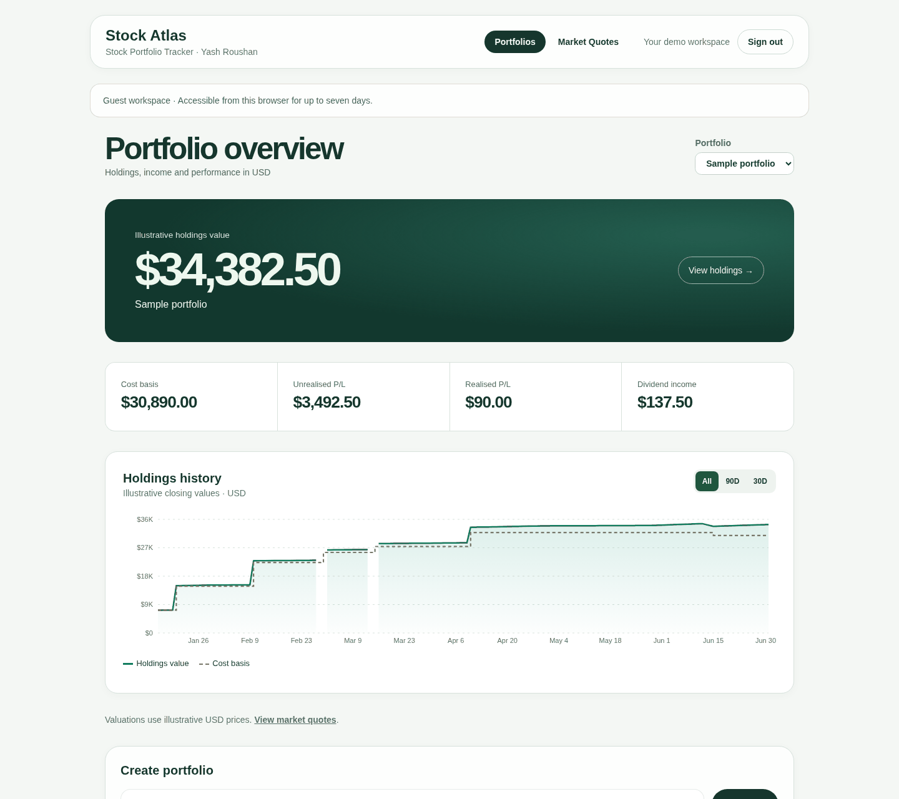
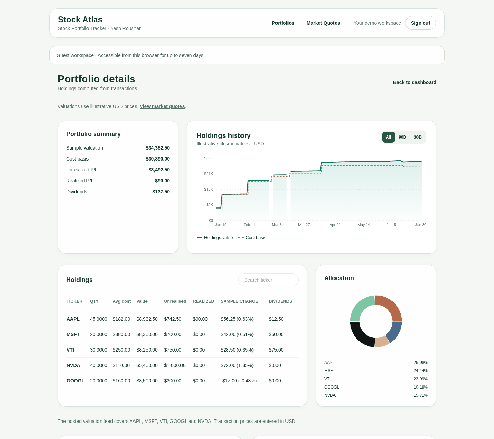

# Stock Portfolio Tracker

[Open the live demo](https://yash-stock-portfolio-tracker.yashroushan.chatgpt.site) · [Yash’s portfolio](https://yashroushan.github.io/portfolio-website/engineering/)

Full-stack app for tracking multi-portfolio holdings, live prices, and dividend income. Built with React + Vite + TailwindCSS + Recharts, Node + Express + Prisma, PostgreSQL, and JWT auth.

## Architecture

```
.
├── backend
│   ├── prisma
│   │   └── schema.prisma
│   ├── src
│   │   ├── middleware
│   │   ├── routes
│   │   ├── services
│   │   └── utils
│   └── tests
├── frontend
│   └── src
│       ├── api
│       ├── components
│       ├── hooks
│       ├── lib
│       └── pages
└── docker-compose.yml
```

### Database schema (Prisma)

- User
  - id, email, passwordHash
- Portfolio
  - id, name, userId
- Transaction
  - id, portfolioId, userId, ticker, type, quantity, priceCents, feeCents, occurredAt
- Dividend
  - id, portfolioId, userId, ticker, amountCents, occurredAt

Money values are stored in cents as integers. Tickers are stored in uppercase.

## Core features

- Auth: register/login/logout with JWT
- Portfolios + transactions (BUY/SELL) with cost-basis calculation
- Live pricing with server-side caching (TTL configurable)
- Metrics: avg cost, unrealized/realized P/L, daily change, allocation
- Dividends: manual entry (provider-ready API contract)
- Charts: portfolio value trend and allocation pie
- Input validation (zod) and password hashing (bcrypt)

## Hosted demo

The online version has a one-click guest workspace, saved portfolio records and a [Market Quotes page](https://yash-stock-portfolio-tracker.yashroushan.chatgpt.site/market) with delayed TradingView quotes. Portfolio calculations use labelled illustrative USD prices by default and support Tiingo closing prices with a licensed server-side token. See [hosted setup and deployment](hosted/README.md).

## Local setup

### Prerequisites
- Node.js 20+
- PostgreSQL (or Docker)

### Backend

```
cd backend
cp .env.example .env
npm install
npx prisma generate
npx prisma migrate dev
npm run dev
```

### Frontend

```
cd frontend
cp .env.example .env
npm install
npm run dev
```

### Docker Compose

```
cp backend/.env.example backend/.env
cp frontend/.env.example frontend/.env
export ALPHA_VANTAGE_API_KEY=your_key
# or export FMP_API_KEY=your_key and set provider to fmp

docker compose up --build
```

## API endpoints

- `POST /api/auth/register`
- `POST /api/auth/login`
- `GET /api/portfolios`
- `POST /api/portfolios`
- `GET /api/portfolios/:id`
- `GET /api/portfolios/:id/summary`
- `POST /api/transactions`
- `GET /api/transactions?portfolioId=:id`
- `GET /api/prices?tickers=AAPL,MSFT`
- `POST /api/dividends`
- `GET /api/dividends?portfolioId=:id`
- `GET /api/dividends/:ticker`

## Screenshots





## Testing

```
cd backend
npm test
```

## Notes

- Holdings history overlays dated closing valuations and transaction-derived cost basis. Market value is unavailable on dates without a close for every open holding. The hosted demo uses illustrative weekday observations; the licensed mode stores Tiingo closes in D1. The Express backend persists Alpha Vantage or FMP daily history in PostgreSQL. For an existing local PostgreSQL installation, run `npx prisma db push` from `backend/` to add the DailyClose table before starting the updated API.
- Market data provider can be swapped via `MARKET_DATA_PROVIDER` (`alphavantage` or `fmp`).

## Future improvements

- Support multi-currency portfolios and FX conversion.
- Scheduled background jobs for dividends and end-of-day prices.

## Resume bullets

- Built a production-grade stock portfolio tracker (React, Vite, Tailwind, Node, Express, Prisma, Postgres) with JWT auth, protected routes, and Dockerized local dev.
- Implemented transaction-driven holdings with cents-based arithmetic, real-time pricing cache (60s TTL), and computed KPIs for unrealized/realized P/L and allocation.
- Delivered dashboards with Recharts visualizations, dividend tracking, and API tests via Jest + Supertest.
